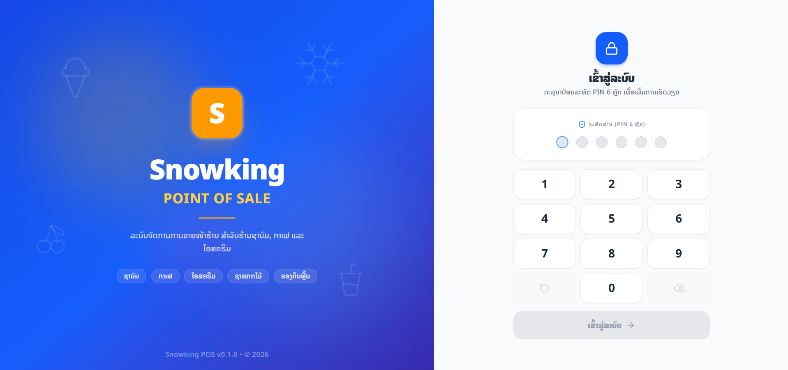
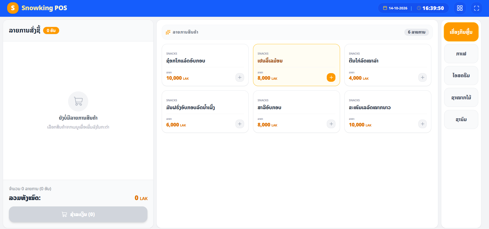
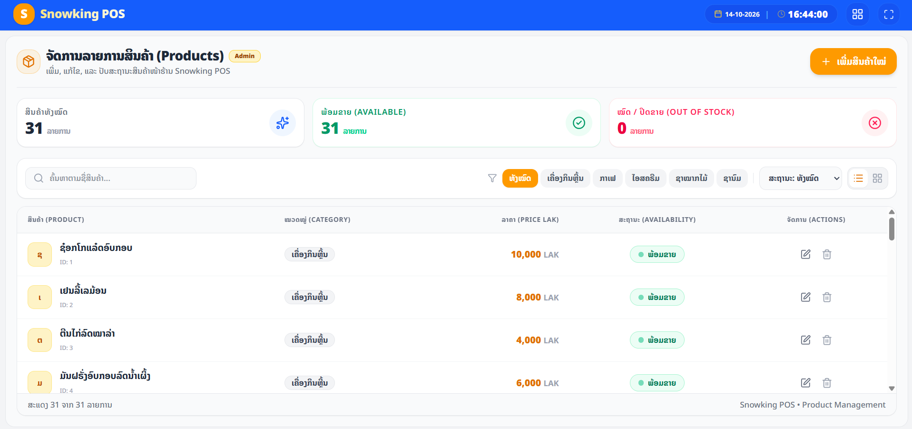

# POS System

A web-based Point of Sale (POS) application designed for beverage store operations.

[Live Demo](https://snowking-pos.ahriew2002.workers.dev/login) · [GitHub Repository](https://github.com/ahriew-laotor/snowking-pos)

## Preview

<!-- Replace with an actual screenshot of your application -->




## Features

- **Cashier Interface** — A user interface for cashier operations.
- **Cart Management** — Add, remove, and manage products in the cart.
- **Order Summary** — Display selected products and order totals.
- **Payment Calculations** — Calculate payment amounts and change.
- **Product Management** — Manage product and menu information.
- **Product Modifiers** — Manage product options and modifiers.

## Tech Stack

- Next.js
- React
- TypeScript
- Tailwind CSS
- Supabase
- Cloudflare Workers

## Demo Access

- **Admin Password:** `111111`
- **Stuff Password:** `888888`

## Getting Started

### Prerequisites

- Node.js
- npm
- A Supabase project with the required environment variables

### Installation

1. Clone the repository.

   ```bash
   git clone https://github.com/ahriew-laotor/snowking-pos
   cd snowking-pos
   ```

2. Install dependencies.

   ```bash
   npm install
   ```

3. Configure environment variables.

   Create a `.env.local` file in the project root and add the required Supabase configuration.

4. Start the development server.

   ```bash
   npm run dev
   ```

5. Open [http://localhost:3000](http://localhost:3000) in your browser.

## Planned Features

- Order checkout and order history
- Receipt printing
- Inventory and recipe management
- Kitchen Display System (KDS)
- Sales dashboard and reports

## Project Status

This project is under active development. Features are being added and improved incrementally.

## Author

**Ahriew Laotor**

[GitHub](https://github.com/ahriew-laotor) · [Portfolio](https://ahriew-portfolio.ahriew2002.workers.dev/)